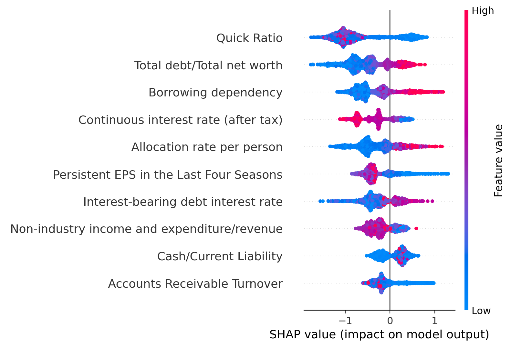

## Project 1: Bankruptcy prediction with explainable ML (Taiwan, UCI)

**Question:** Can financial ratios predict firm bankruptcy, and which ratios matter most?
**Data:** UCI Taiwanese Bankruptcy Prediction (6,819 firms, 95 ratios, 220 bankrupt, 1999-2009), CC BY 4.0.
**Method:** Stratified 70/30 split before any modelling; class weights instead of resampling (no leakage); Logistic Regression, Random Forest, XGBoost; 5-fold CV on the training data; SHAP.
**Metrics:** Recall, precision, PR-AUC, ROC-AUC (accuracy not used because of the 3% base rate).

### Results (test set)
| Model | Recall | Precision | PR-AUC | ROC-AUC |
|---|---|---|---|---|
| Logistic Regression | 0.712 | 0.166 | 0.275 | 0.883 |
| Random Forest | 0.182 | 0.632 | 0.414 | 0.943 |
| XGBoost | 0.500 | 0.465 | 0.457 | 0.949 |

5-fold CV PR-AUC (training data): LR 0.357 ± 0.083, RF 0.382 ± 0.050, XGBoost 0.411 ± 0.040.

### Findings
XGBoost performed slightly better, but the differences between models were within one standard deviation.
Top SHAP features: Quick Ratio, Total debt/Total net worth, Borrowing dependency (liquidity and leverage).

### Limitations
Single dataset (Taiwan, 1999-2009); only about 66 bankrupt firms in the test set, so estimates are noisy; SHAP shows association, not causation; default 0.5 threshold used.

## Project 2 (in progress): Reporting irregularities in Pakistani listed firms
Goal: apply the same pipeline to PSX-listed firms using Beneish ratios and regulator-action labels.
Status: work in progress. Started November 2026.
